<!-- Personalized GitHub profile: Bhargav12-surya/Bhargav12-surya -->

  <picture>
    <source media="(prefers-color-scheme: dark)" srcset="https://raw.githubusercontent.com/Bhargav12-surya/Bhargav12-surya/main/hero-dark-v4.svg" />
    <source media="(prefers-color-scheme: light)" srcset="https://raw.githubusercontent.com/Bhargav12-surya/Bhargav12-surya/main/hero-light-v4.svg" />
    
  </picture>

  <a href="https://www.linkedin.com/in/bhargav-ram01">LinkedIn</a>
  &nbsp;·&nbsp;
  <a href="mailto:rambhargav313@gmail.com">Email</a>
  &nbsp;·&nbsp;
  <a href="https://github.com/Bhargav12-surya?tab=repositories">Repositories</a>

  <h2>About Me</h2>

  <table>
    <tr>
      <td width="38%" valign="top">
        <picture>
          <source media="(prefers-color-scheme: dark)" srcset="https://raw.githubusercontent.com/Bhargav12-surya/Bhargav12-surya/main/signal-dark-v4.svg" />
          <source media="(prefers-color-scheme: light)" srcset="https://raw.githubusercontent.com/Bhargav12-surya/Bhargav12-surya/main/signal-light-v4.svg" />
          
        </picture>
      </td>
      <td width="62%" valign="top">
        <picture>
          <source media="(prefers-color-scheme: dark)" srcset="https://raw.githubusercontent.com/Bhargav12-surya/Bhargav12-surya/main/info-dark-v4.svg" />
          <source media="(prefers-color-scheme: light)" srcset="https://raw.githubusercontent.com/Bhargav12-surya/Bhargav12-surya/main/info-light-v4.svg" />
          
        </picture>
      </td>
    </tr>
  </table>

I'm a B.Tech student in **Artificial Intelligence & Data Science** at **Amrita Vishwa Vidyapeetham, Faridabad**. I enjoy building machine learning projects from initial experiments to evaluated, documented results — especially in **medical imaging and scientific AI**.

## Featured Projects

| Project | What I worked on | Tools / Areas |
| :--- | :--- | :--- |
| **[MSF-HSAT — 3D Lung Tumor Segmentation](https://github.com/Bhargav12-surya/CV-lung-segmentation-)** | A 3D thoracic CT tumor-segmentation pipeline using multi-scale fusion, wavelet attention, and transformers, compared against a 3D U-Net baseline. *Research prototype; not a clinical diagnostic tool.* | `PyTorch` `3D CNN` `Transformers` `Medical Imaging` |
| **[Ultrasound Elastography — Phase 1](https://github.com/Amith-vignesh700/MIS_ETP)** | Collaborative academic work on self-supervised ultrasound RF alignment, displacement estimation, and axial strain calculation. | `Python` `CNN` `Image Registration` |
| **[ElastoRisk — Phase 2](https://github.com/Bhargav12-surya/elastorisk-mis-phase-2-)** | Reliability analysis using probabilistic inference, HMMs, spatial reasoning, and cost-aware decisions. *Research analysis, not a clinically validated system.* | `Bayesian Models` `EM` `HMM` `MRF` |

**Other project:** Hybrid ML–DL Crystal Structure–Property Modeling — exploring graph, convolutional, and multi-task models for material-property prediction.

## Technical Skills

| Area | Stack |
| :--- | :--- |
| **Programming** | Python · Java |
| **ML / Data** | scikit-learn · NumPy · Pandas · SciPy |
| **Deep Learning** | PyTorch · CNNs · Transformers · Graph Neural Networks |
| **Development** | Git · GitHub · Jupyter Notebook · VS Code |
| **Interests** | Computer Vision · Medical Imaging · Probabilistic AI · Scientific ML |

## Certifications &amp; Learning

- **Oracle Cloud Infrastructure** — AI Foundations Associate (2025)
- **Cisco Networking Academy** — Introduction to Modern AI
- **Quantium / Forage** — Data Analytics Job Simulation
- **Tata / Forage** — GenAI-Powered Data Analytics Job Simulation

---

  Building carefully, learning continuously, and documenting what works.

