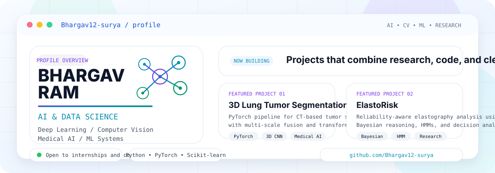

<!-- GitHub profile repository: Bhargav12-surya/Bhargav12-surya -->

<picture>
  <source media="(prefers-color-scheme: dark)" srcset="https://raw.githubusercontent.com/Bhargav12-surya/Bhargav12-surya/main/dark.svg">
  <source media="(prefers-color-scheme: light)" srcset="https://raw.githubusercontent.com/Bhargav12-surya/Bhargav12-surya/main/light.svg">
  
</picture>

### Hi, I'm Bhargav Ram 👋

**AI & Data Science undergraduate · Deep learning · Computer vision · ML systems**

I build and evaluate machine learning systems, with a particular interest in medical imaging, scientific computing, and optimization. I enjoy understanding not only whether a model works, but *why* it works and where its limits are.

## About me

- 🎓 B.Tech in **Artificial Intelligence & Data Science** at **Amrita Vishwa Vidyapeetham**, Faridabad (2024–2028).
- 🔬 Interested in **3D medical image segmentation, machine learning systems, and uncertainty-aware AI**.
- 🛠️ I like building end-to-end experiments: preprocessing, model training, evaluation, and reproducible reports.
- 🤝 Open to **AI/ML internships, research opportunities, and technical collaboration**.

## Tools I work with

**Programming:** Python · Java  
**Machine learning:** PyTorch · scikit-learn · NumPy · Pandas · SciPy  
**Areas:** CNNs · Transformers · Graph Neural Networks · Supervised / Unsupervised Learning · Probabilistic Models  
**Workflow:** Git · Jupyter Notebook · Model Evaluation · Data Pipelines

## Featured projects

### 🫁 [MSF-HSAT — 3D Lung Tumor Segmentation](https://github.com/Bhargav12-surya/CV-lung-segmentation-)

A PyTorch research pipeline for segmenting annotated primary tumors in thoracic CT scans. Combines multi-scale 3D convolutions, transformer context, wavelet attention, and adaptive decoder fusion; compares performance with a 3D U-Net baseline. **Research prototype — not for clinical diagnosis.**

`Python` · `PyTorch` · `3D CNN` · `Transformers` · `Medical Imaging`

### 🧠 [ElastoRisk — Ultrasound Elastography & Reliability Analysis](https://github.com/Bhargav12-surya/elastorisk-mis-phase-2-)

Part of a two-phase academic project exploring self-supervised ultrasound RF alignment, tissue displacement and strain estimation, and probabilistic reliability analysis. Includes Bayesian inference, hidden-state models, spatial reasoning, and cost-aware decisions.

`Python` · `CNN` · `Bayesian Inference` · `HMM` · `Risk Analysis`

### ⚙️ [AI-Driven CPU–GPU Workload Scheduling](https://github.com/Bhargav12-surya/AI-Driven-Adaptive-CPU-GPU-Workload-Scheduling-and-Resource-Optimization-Cloud-HPC)

**Collaborative academic project (fork).** Explores ML-assisted device placement, dependency-aware scheduling, and multi-objective optimization across CPU and GPU resources, with a Plotly Dash interface. The reported energy metrics use an **energy-estimation model**, rather than direct power measurements.

`Python` · `scikit-learn` · `Optimization` · `HPC` · `Plotly Dash`

<strong>More work and interests</strong>

- **Crystal structure–property modeling:** hybrid graph and convolutional neural network concepts for scientific property prediction.
- **Smart City — Footstep Power Generation:** educational prototype involving piezoelectric sensors and energy harvesting.

## Certifications & learning

- **Oracle Cloud Infrastructure** — AI Foundations Associate (2025)
- **Cisco Networking Academy** — Introduction to Modern AI
- **Quantium / Forage** — Data Analytics Job Simulation
- **Tata / Forage** — GenAI-Powered Data Analytics Job Simulation

---

  Thanks for visiting. For projects or collaboration, reach out through LinkedIn or email.

